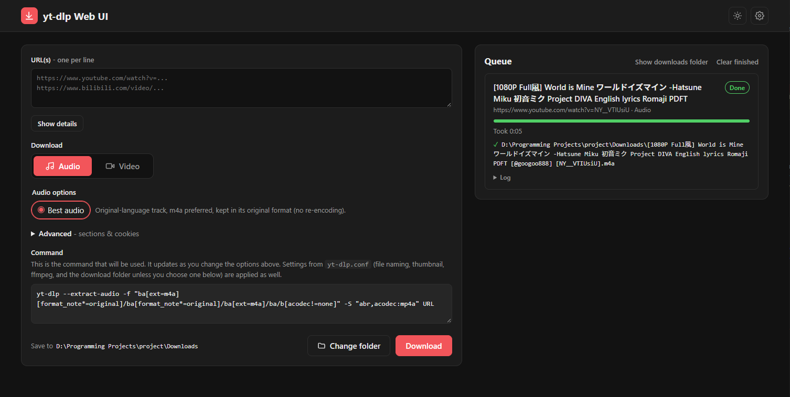

# yt-dlp Web UI

A local Flask web interface for [yt-dlp](https://github.com/yt-dlp/yt-dlp), served at http://127.0.0.1:5000. Run `start.bat` to launch it.



## Setup

These steps are for Windows. `start.bat` and the app expect the virtual environment at `venv\Scripts\python.exe`.

### 1. Install the prerequisites

- [Python](https://www.python.org/downloads/) 3.10 or newer.
- [Node.js](https://nodejs.org/). yt-dlp uses it as a JavaScript runtime for full YouTube support (`--js-runtimes node` in `yt-dlp.conf`).

### 2. Create the virtual environment

From the project folder:

```bat
python -m venv venv
venv\Scripts\python.exe -m pip install -r requirements.txt
```

If you skip the install step, `start.bat` installs the requirements the first time it runs.

### 3. Add ffmpeg

ffmpeg isn't in the repository because its binaries are too large for GitHub.

1. Download the **essentials** build from [gyan.dev](https://www.gyan.dev/ffmpeg/builds/).
2. Extract it into the `yt-dlp` folder. `ffmpeg.exe` and `ffprobe.exe` should end up in `yt-dlp\<ffmpeg folder>\bin\`.
3. Open `yt-dlp\yt-dlp.conf` and change `--ffmpeg-location` to match your folder's name:

   ```
   --ffmpeg-location "ffmpeg-<version>-essentials_build\bin"
   ```

   The path is relative to the `yt-dlp` folder.

### 4. Run it

Double-click `start.bat`. The UI opens in your browser at http://127.0.0.1:5000. Downloads are saved to the `Downloads` folder in the project root. To save them somewhere else, click **Change folder** next to the Download button. Your choice is saved in `settings.json` in the project root and used again the next time. Click **Reset** to go back to the `Downloads` folder.

To update yt-dlp, use the update option in the UI, or run:

```bat
venv\Scripts\python.exe -m pip install -U "yt-dlp[default]"
```
